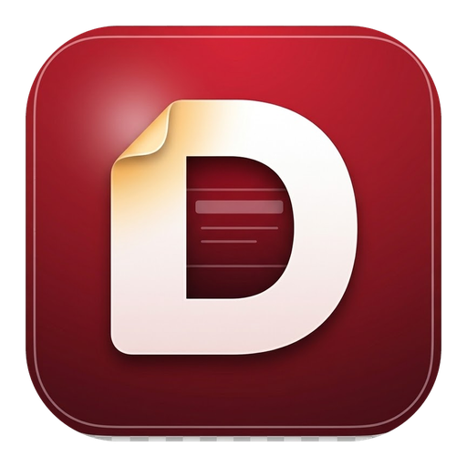

# DraftDeck — downloads

*[English version](README.en.md)*

DraftDeck é um editor de apresentações para macOS e Windows, feito como hobby.
**É gratuito e não aceita pagamento de nenhum tipo**: sem venda, assinatura, anúncios ou doações.
Não é uma oferta comercial e não está em nenhuma loja.

Baseado no [DeckCraft](https://github.com/storytold/deckcraft) (MIT OR Apache-2.0), com interface,
ícones e temas próprios. Os avisos de licença e as atribuições vão dentro de cada pacote.

## Downloads

| Sistema | Arquivo | Observações |
|---|---|---|
| macOS 11+ (Intel e Apple Silicon) | [`macOS/`](macOS/) — `.dmg` universal | Assinado com Developer ID e notarizado pela Apple: abre sem avisos. Arraste o DraftDeck para Aplicativos. |
| Windows 10/11 (x64) | [`windows/`](windows/) — `.msi` ou `.zip` portátil | Sem certificado de assinatura: na primeira abertura o SmartScreen pode avisar; escolha "Mais informações › Executar assim mesmo". |

Cada arquivo tem um `.sha256` ao lado para conferência.

## Como instalar

### macOS

1. Entre na pasta [`macOS/`](macOS/), clique no arquivo `.dmg` e depois no botão **Download**.
2. Abra o arquivo baixado. Aparece uma janela com o ícone do DraftDeck e a pasta Aplicativos.
3. Arraste o DraftDeck para Aplicativos.
4. Abra o DraftDeck pelo Launchpad ou pela pasta Aplicativos. Não há aviso: o app é notarizado pela Apple.
5. Pode ejetar o disco "DraftDeck" e apagar o `.dmg`.

### Windows

1. Entre na pasta [`windows/`](windows/), clique no arquivo `.msi` e depois no botão **Download**.
2. Dê dois cliques no arquivo baixado.
3. Se aparecer a tela azul "O Windows protegeu o computador", clique em **Mais informações** e depois em **Executar assim mesmo**. O botão só aparece depois de "Mais informações". É o SmartScreen avisando que o app não tem certificado pago; acontece só na primeira vez.
4. Siga o instalador: aceitar a licença, Instalar, Concluir. Ele pode pedir a senha de administrador.
5. O DraftDeck fica no menu Iniciar.

**Sem permissão para instalar programas?** Baixe o `.zip` portátil, descompacte numa pasta sua (Documentos, por exemplo) e abra o `DraftDeck.exe` de dentro dela. Nada é instalado.

### Atualizar

Baixe o arquivo da versão nova e instale por cima. As apresentações ficam onde você salvou; a instalação não mexe nelas.

## Versão atual

0.7.0-draftdeck.1 (15/out/2026).

Novidades: primeira versão. Interface Manzana (Linha, Biblioteca, Trilho) nas três aparências Manzana, Céu e Grafite, em português do Brasil, inglês e espanhol; salvamento automático em arquivo aberto e recuperação de apresentações; botão Fechar; abre e salva `.pptx`.

## Código-fonte

O código do DraftDeck fica em um repositório privado. Este repositório guarda só os instaladores.
